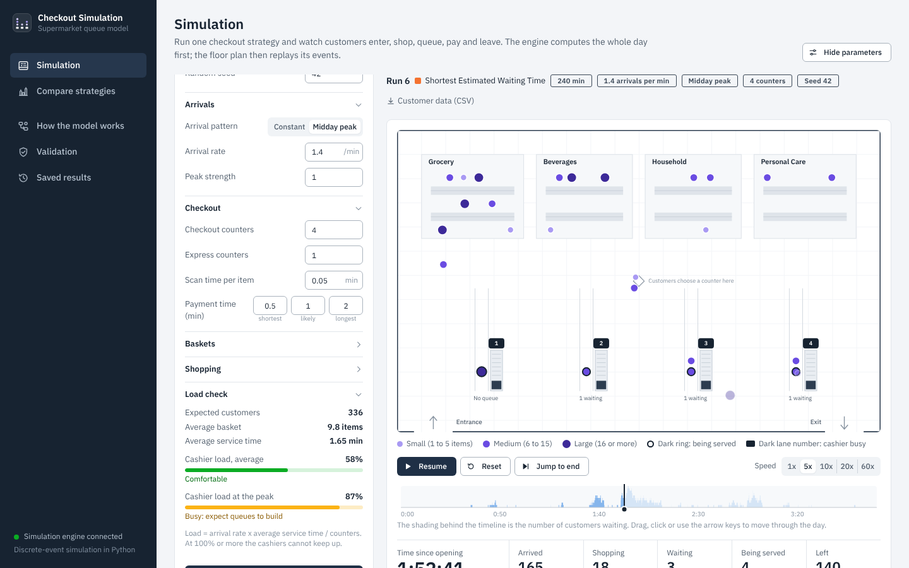
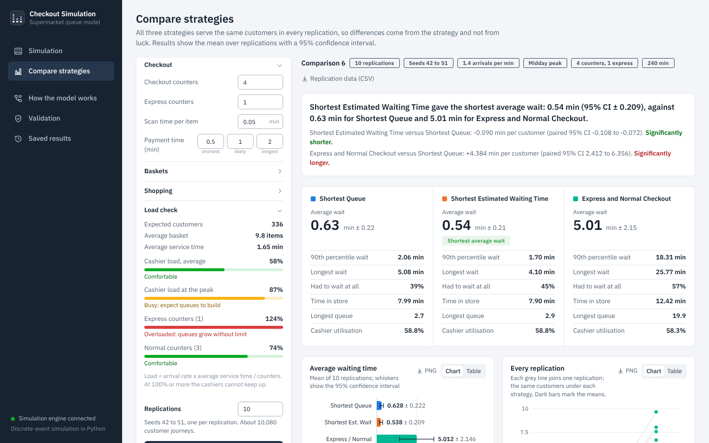
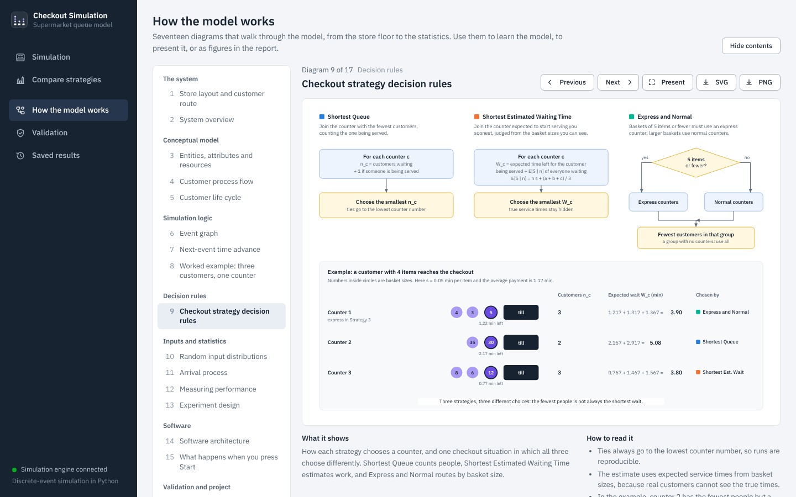

# Supermarket Customer Movement, Queue and Checkout Simulation

A Discrete-Event Simulation (DES) of customers entering a supermarket, shopping
in four sections, choosing a checkout counter, queueing, paying and leaving. It
compares three checkout strategies on identical customer streams and explains
the model through seventeen diagrams.



- `api/` — Python simulation engine (`api/simulation`) and Django API (`api/simulator`)
- `web/` — React + TypeScript interface
- `docs/` — requirements, conceptual model, mathematical model, architecture,
  testing and validation, plan and report outline, and the model diagrams

## What the app does

| Page | What you can do |
|---|---|
| **Simulation** | Set parameters (with a live load check), choose a strategy and press **Start simulation**. The whole day is simulated on the server, then the floor plan replays it. **Pause**, **Resume**, **Reset**, jump to the end, change the speed, or drag the timeline, whose shading shows when queues build. Results include every required measure, queue charts per counter, waiting-time distribution, cashier utilisation and a log of every customer. |
| **Compare strategies** | Run all three strategies on the same customers for several replications. See a plain-language verdict, means with 95% confidence intervals, paired significance tests, every replication, and waits by basket size. |
| **How the model works** | Walk through 17 diagrams: store layout, conceptual model, process flow, life cycle, event graph, engine loop, a worked example, strategy rules, distributions, arrivals, measures, experiment design, architecture, request sequence, validation and stages. **Present** opens them full screen; **SVG** and **PNG** download them for the report. |
| **Validation** | Check the engine against exact M/M/1 queueing formulas. |
| **Saved results** | Reopen or delete stored runs and comparisons. Every result can be reproduced from its seed. |





## Requirements

- Python 3.10 or newer
- Node.js 20 or newer

## Setup on Windows (PowerShell)

### 1. API (terminal 1)

```powershell
cd api
python -m venv .venv
.\.venv\Scripts\Activate.ps1
pip install -r requirements.txt
python manage.py migrate
python manage.py runserver
```

If PowerShell blocks the activate script, run this once, then activate again:

```powershell
Set-ExecutionPolicy -Scope CurrentUser RemoteSigned
```

The API is now at http://127.0.0.1:8000/api/meta

### 2. Web interface (terminal 2)

```powershell
cd web
npm install
npm run dev
```

Open http://localhost:5173. Vite forwards `/api` requests to Django, so both
servers must be running.

### Single-server mode (for a demo or the presentation)

Build the interface once; Django then serves it together with the API, so only
one terminal is needed:

```powershell
cd web
npm run build
cd ..\api
.\.venv\Scripts\Activate.ps1
python manage.py runserver
```

Open http://127.0.0.1:8000. Run `npm run build` again after changing the web code.

## Deploying to a server

`deploy/` holds everything needed to run the app at supermarket.virontech.me:
nginx serves the built web app and proxies `/api/` to Django under gunicorn and
PM2, with rate limits on the requests that run simulations. On the server:

```bash
cd /home/modeling-project && bash deploy/deploy.sh
```

The one-time setup (Python venv, PM2, `api/.env` with the secret key), the nginx
and HTTPS steps and the checks are in [deploy/README.md](deploy/README.md).

## Engine without the web interface

```powershell
cd api
python -m simulation.cli --strategy shortest_queue --seed 42
python -m simulation.cli --strategy express --csv customers.csv
python -m simulation.cli --compare --replications 10
python -m simulation.cli --validate
```

Strategies: `shortest_queue`, `shortest_wait`, `express`.

## Tests

```powershell
cd api
python -m unittest discover -s simulation/tests -t . -v
python manage.py test simulator
```

## Documentation

| Stage | Document |
|---|---|
| 1. Requirements analysis | [docs/01-requirements.md](docs/01-requirements.md) |
| 2. Conceptual modelling | [docs/02-conceptual-model.md](docs/02-conceptual-model.md) |
| 3. Mathematical modelling and assumptions | [docs/03-mathematical-model.md](docs/03-mathematical-model.md) |
| 4. Architecture and setup | [docs/04-architecture.md](docs/04-architecture.md) |
| 5–8. Engine, strategies, interface, analysis | Code in `api/` and `web/` |
| 9. Testing and validation | [docs/05-testing-validation.md](docs/05-testing-validation.md) |
| 10. Plan, report and presentation | [docs/06-plan-and-report.md](docs/06-plan-and-report.md) |
| Model diagrams | [docs/07-diagrams.md](docs/07-diagrams.md) |
