# Model diagrams

The web app's **How the model works** page walks through these diagrams one at a time, with
Previous and Next buttons, a full-screen **Present** mode for the presentation, and **SVG** and
**PNG** downloads for the report. The diagrams marked *uses your parameters* (1, 10 and 11) are
redrawn in the app from whatever parameters are currently set; the copies below use the defaults.

The SVG files in `docs/diagrams/` were exported from the app and can be inserted directly into a
Word or Google document, or opened in any browser.

## Contents

1. [Store layout and customer route](#1-store-layout-and-customer-route)
2. [System overview](#2-system-overview)
3. [Entities, attributes and resources](#3-entities-attributes-and-resources)
4. [Customer process flow](#4-customer-process-flow)
5. [Customer life cycle](#5-customer-life-cycle)
6. [Event graph](#6-event-graph)
7. [Next-event time advance](#7-next-event-time-advance)
8. [Worked example: three customers, one counter](#8-worked-example-three-customers-one-counter)
9. [Checkout strategy decision rules](#9-checkout-strategy-decision-rules)
10. [Random input distributions](#10-random-input-distributions)
11. [Arrival process](#11-arrival-process)
12. [Measuring performance](#12-measuring-performance)
13. [Experiment design](#13-experiment-design)
14. [Software architecture](#14-software-architecture)
15. [What happens when you press Start](#15-what-happens-when-you-press-start)
16. [Validation against queueing theory](#16-validation-against-queueing-theory)
17. [Development stages](#17-development-stages)

## The system

### 1. Store layout and customer route

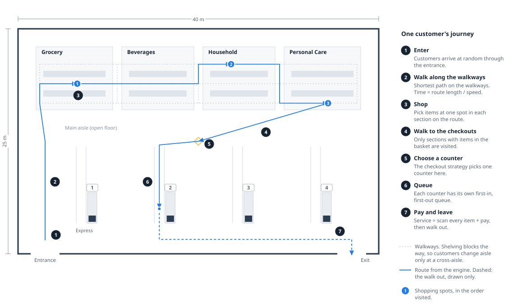

The simulated supermarket drawn to scale: four sections along the back with their shelving, the checkout lanes at the front, the walkways customers use, and the route one customer takes from the entrance to the exit. The engine measures walking on exactly these walkways, and the animation follows the same routes.

How to read it:

- Shelving blocks the way: customers walk along an aisle, change aisle only at a cross-aisle, and cross the open main aisle to reach the checkouts.
- Numbered blue stops are the customer's shopping spots, one in each section they buy from, in store order.
- Walking time is the length of the route divided by the customer's walking speed.
- The diamond is where the strategy chooses a counter; each counter's queue forms in its lane. The dashed walk out after paying is drawn only.

### 2. System overview

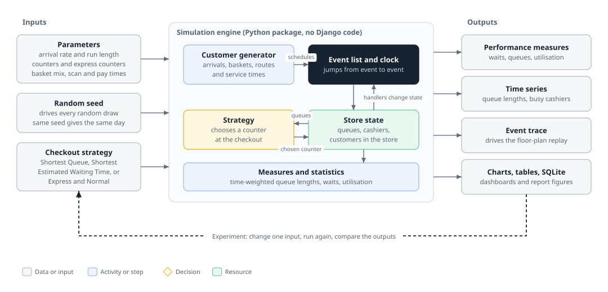

What goes into the simulation, what happens inside it and what comes out. Every experiment follows the same loop: change one input, run again and compare the outputs.

How to read it:

- Inputs on the left are the parameters, the random seed and the strategy.
- Inside the engine, the event list drives everything; the strategy is consulted only at the checkout.
- Outputs on the right are stored in SQLite and shown as dashboards, tables and report figures.

## Conceptual model

### 3. Entities, attributes and resources

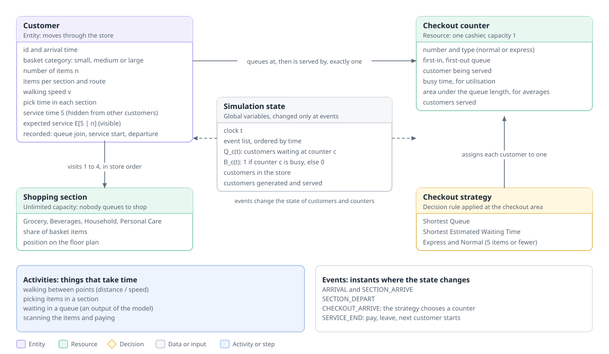

The building blocks of the conceptual model. Customers are the entities that move; checkout counters are resources with a capacity of one; sections have unlimited capacity; the strategy is a decision rule; the simulation state holds the clock, the event list and the state variables.

How to read it:

- A customer's service time is fixed when the customer is generated, so every strategy faces the same workload.
- Strategies can only use what a shopper could see: basket sizes, not true service times.
- Activities take time; events are instants where the state changes.

### 4. Customer process flow

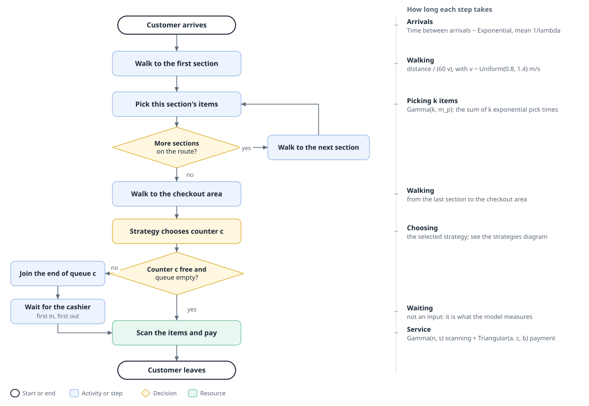

The journey of one customer as a flowchart, from arrival to departure, with the probability distribution behind every step that takes time.

How to read it:

- The loop at the top repeats once for every section on the customer's route.
- The second diamond decides whether the customer waits: only when the chosen counter is busy or already has a queue.
- Waiting time is not an input. It is what the model measures.

### 5. Customer life cycle

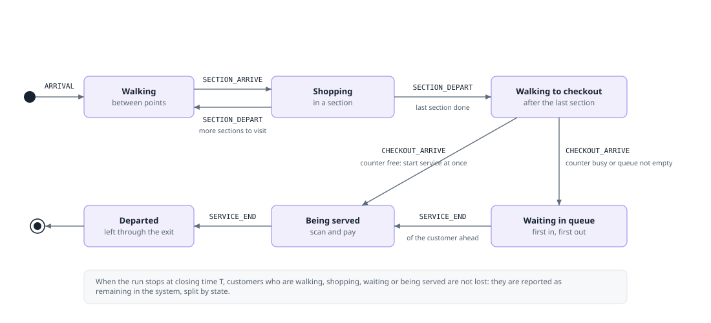

The states a customer can be in and the events that move them from one state to the next. This is the same information as the process flow, seen from the point of view of the state variables.

How to read it:

- Each arrow is labelled with the event that causes the change.
- A customer whose counter is free skips the waiting state entirely.
- At closing time anyone not yet departed is counted as remaining, split by state.

## Simulation logic

### 6. Event graph

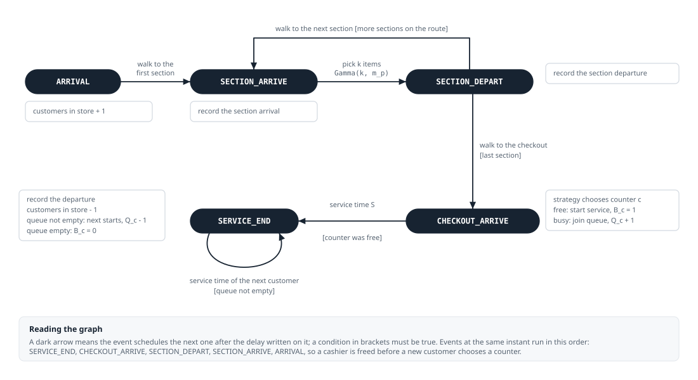

The five event types and how each one schedules the next. This is the core of a discrete-event simulation: every change in the model happens inside one of these events.

How to read it:

- Each arrow carries a delay (how long until the next event) and sometimes a condition in brackets.
- The notes next to each event list the state changes it makes.
- The fixed order of events at equal times makes runs reproducible and frees cashiers before new customers choose.

### 7. Next-event time advance

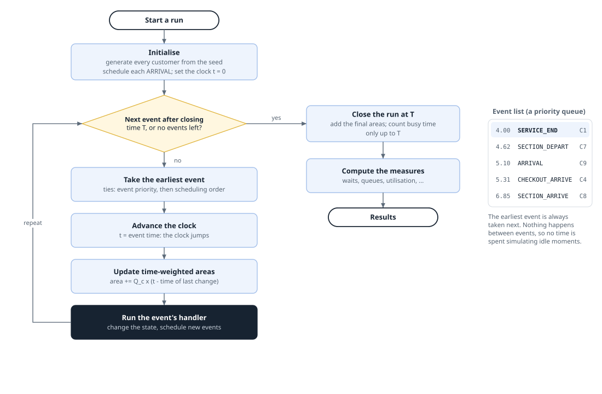

The main loop of the engine. The clock does not tick minute by minute: it jumps straight to the next event in the event list, which is a priority queue ordered by time.

How to read it:

- Before each handler runs, the areas under the queue-length curves are brought up to date.
- The loop stops at the first event after closing time T, not after the last customer.
- Closing adds the final areas and counts busy time only up to T, so utilisation never exceeds 100%.

### 8. Worked example: three customers, one counter

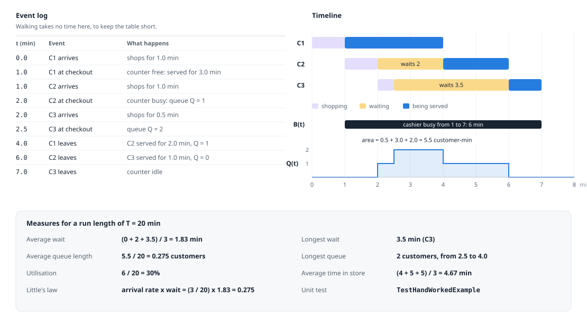

A run small enough to check by hand. The event log, the timeline, the queue length Q(t) and every measure can be worked out with a pencil, and the unit tests check that the engine gets exactly these numbers.

How to read it:

- Read the event log from top to bottom and follow the same moments on the timeline.
- The shaded area under Q(t) is the total customer-minutes spent waiting.
- Average wait multiplied by the arrival rate equals the average queue length (Little's law).

## Decision rules

### 9. Checkout strategy decision rules

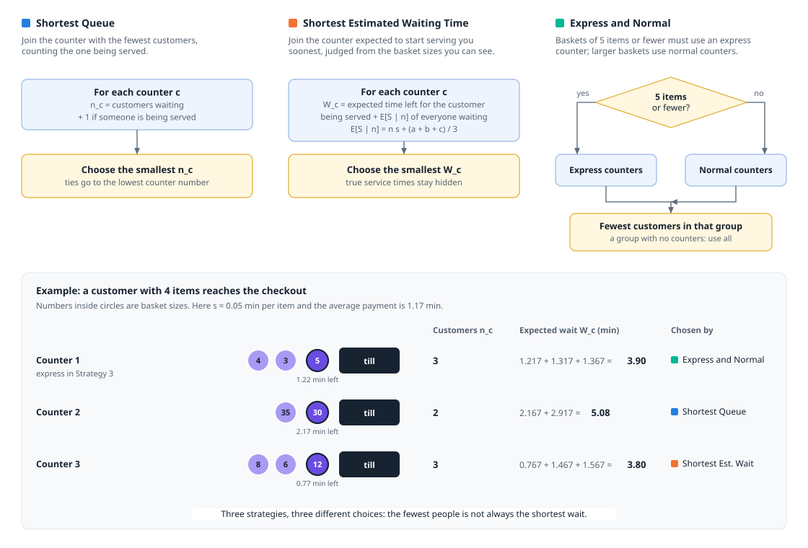

How each strategy chooses a counter, and one checkout situation in which all three choose differently. Shortest Queue counts people, Shortest Estimated Waiting Time estimates work, and Express and Normal routes by basket size.

How to read it:

- Ties always go to the lowest counter number, so runs are reproducible.
- The estimate uses expected service times from basket sizes, because real customers cannot see the true times.
- In the example, counter 2 has the fewest people but a 35-item basket waiting, so it is not the quickest.

## Inputs and statistics

### 10. Random input distributions

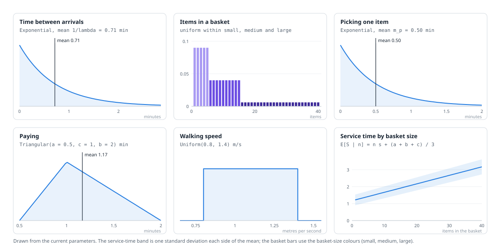

The probability distributions that generate the random parts of the model, drawn from the parameters you have set. Change a parameter on the Simulation page and these charts change with it.

How to read it:

- Exponential distributions describe memoryless times: arrivals and picking one item.
- The triangular distribution gives payment a shortest, a most likely and a longest time.
- Service time grows with the basket: about 0.05 minutes per item plus the payment.

### 11. Arrival process

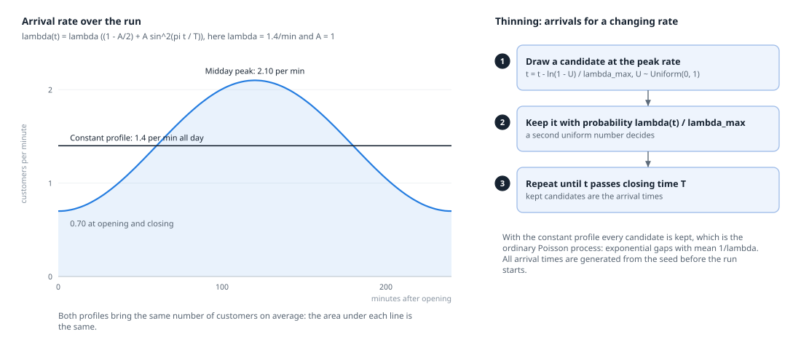

Customers arrive as a Poisson process. With the constant profile the rate is the same all day; with the midday peak it rises and falls, while the average over the run stays the same. A changing rate is generated by thinning.

How to read it:

- The blue curve is the arrival rate lambda(t) for the midday peak; the dark line is the constant rate.
- Thinning generates candidates at the highest rate and keeps each with probability lambda(t) / lambda_max.
- All arrival times are produced from the seed before the run, which keeps strategy comparisons fair.

### 12. Measuring performance

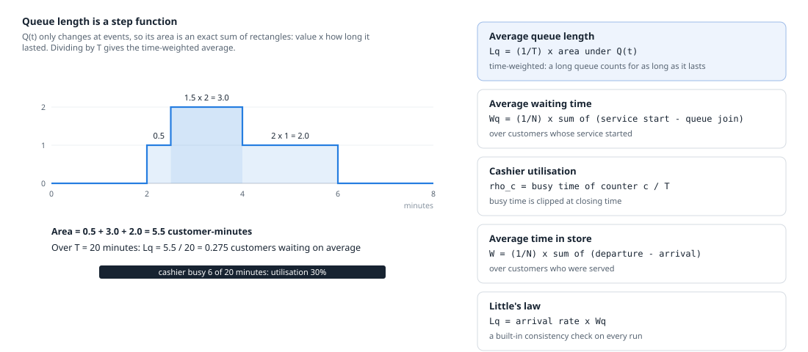

How the performance measures are calculated. Queue length and utilisation are averaged over time, because a long queue matters for as long as it lasts; waiting time and time in store are averaged over customers.

How to read it:

- The three shaded rectangles add up to the area under Q(t) for the worked example.
- Little's law links the two kinds of average and is checked on every run.
- The dashboard also reports the 90th percentile wait and the share of customers who waited at all.

### 13. Experiment design

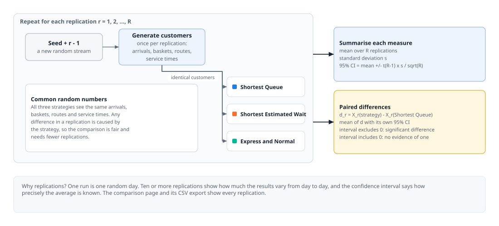

How strategies are compared fairly. Each replication generates one set of customers and gives it to all three strategies (common random numbers). Repeating with new seeds gives confidence intervals and paired tests.

How to read it:

- The frame is repeated R times, once per seed.
- Paired differences remove most of the day-to-day noise, so smaller differences can be detected.
- An interval for the difference that excludes zero means the strategies really differ.

## Software

### 14. Software architecture

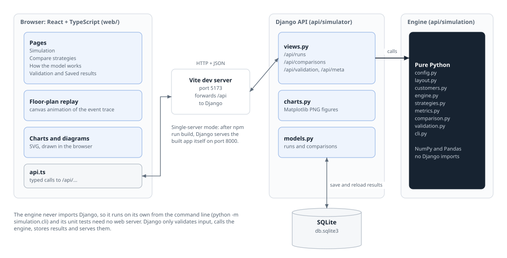

How the parts of the application fit together. The simulation engine is a plain Python package; Django wraps it in a JSON API and stores results; React draws the interface, the replay and the charts.

How to read it:

- Arrows with two heads are request and reply over HTTP; the engine is called directly as Python functions.
- In development Vite forwards /api to Django; for a demo Django can serve the built interface itself.
- Matplotlib draws the report-ready PNG figures on the server.

### 15. What happens when you press Start

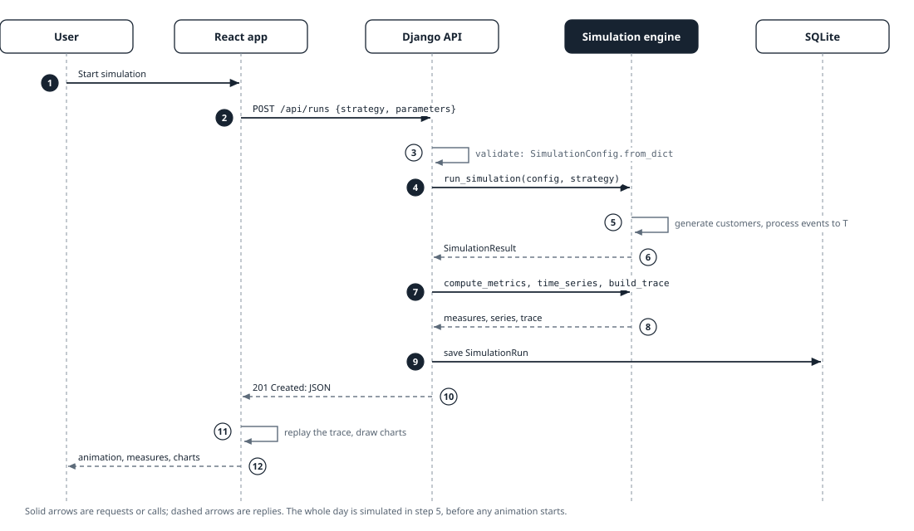

The messages exchanged during one simulation run. The whole trading day is simulated on the server first; the browser then replays the recorded events on a clock you control.

How to read it:

- Numbered steps run from top to bottom.
- Step 5 is the entire simulation, which takes well under a second.
- Pause, Resume and Reset only move the playback clock in the browser; they never re-run the model.

## Validation and project

### 16. Validation against queueing theory

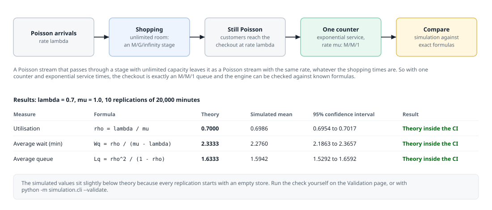

Why the engine can be checked against an exact answer. With one counter and exponential service the model is an M/M/1 queue, whose utilisation, average wait and average queue length are known formulas.

How to read it:

- The chain shows why customers still reach the checkout as a Poisson stream after shopping.
- Each theoretical value lies inside the 95% confidence interval of the simulation.
- The Validation page reruns this check for any arrival and service rate.

### 17. Development stages

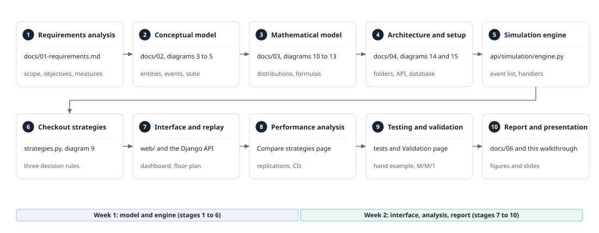

The ten stages of the project in the order they were carried out, with the document, code or page each one produced. Use it as the outline of the report.

How to read it:

- Stages 1 to 4 were completed before any code was written.
- Each card names where to find the result in the repository or the app.
- The two bars at the bottom split the stages across the two weeks.
